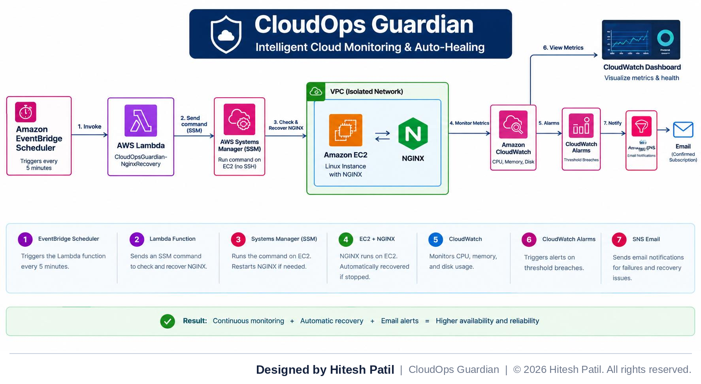

# CloudOps Guardian

**Intelligent Cloud Infrastructure Monitoring & Auto-Healing Platform on AWS**

> **Created and Developed by Hitesh Patil**

CloudOps Guardian is a hands-on AWS project that monitors an EC2 instance and its NGINX web service. CloudWatch collects infrastructure metrics, alarms monitor thresholds, EventBridge Scheduler invokes a Lambda function every five minutes, and Lambda uses AWS Systems Manager Run Command to check NGINX and attempt a restart if it is not active. Amazon SNS is used for email alerts.

  

## Project goals

- Monitor CPU, memory, and disk usage.
- Detect whether NGINX is active.
- Restart NGINX when the health-check command detects it is stopped.
- Run checks on a schedule without relying on SSH for remote command execution.
- Display metrics on a CloudWatch dashboard.
- Send email notifications for detected failures.

## Architecture

**Flow:** scheduled check → Lambda → SSM command → NGINX status/recovery

1. EventBridge Scheduler invokes the Lambda function every five minutes.
2. Lambda calls Systems Manager `SendCommand` using `AWS-RunShellScript` for the managed EC2 instance.
3. The command checks `systemctl is-active nginx`.
4. If NGINX is active, the command reports `NGINX_HEALTHY`.
5. If NGINX is inactive, the command attempts a restart and verifies the service status.
6. Lambda polls the SSM invocation result and publishes an SNS message for configured failure conditions.

CloudWatch metrics, alarms, and the dashboard operate alongside this recovery workflow.

### AWS resources used

| Resource | Purpose | Configured details |
|---|---|---|
| VPC | Network boundary | `cloudops-vpc`; CIDR `10.0.0.0/16` |
| Public subnet | Hosts EC2 in public network | `cloudops-public-1a`; `10.0.1.0/24` |
| EC2 | Runs Amazon Linux 2023 and NGINX | `t3.micro`; managed by SSM |
| CloudWatch / CWAgent | Metrics, alarms, dashboard | `CPUUtilization`, `mem_used_percent`, `disk_used_percent` |
| Lambda | Health check and recovery orchestration | `CloudOpsGuardian-NginxRecovery` |
| EventBridge Scheduler | Periodic trigger | `CloudOpsGuardian-Every5Minutes` |
| SNS | Email notifications | `CloudOps-Guardian-Alerts` |

## Monitoring and alarms

| Alarm | Metric | Threshold | Purpose |
|---|---|---|---|
| `CloudOps-Guardian-High-CPU` | `CPUUtilization` | ≥ 80% | Detect high CPU utilization |
| `CloudOps-Guardian-High-Memory` | `mem_used_percent` | ≥ 80% | Detect high memory use |
| `CloudOps-Guardian-High-Disk` | `disk_used_percent` | ≥ 80% | Detect high root disk use |

The CloudWatch dashboard `CloudOps-Guardian-Dashboard` contains line widgets for CPU, memory, and disk utilization.

## Auto-healing output values

| Value | Meaning |
|---|---|
| `NGINX_HEALTHY` | NGINX was active when checked. |
| `NGINX_DOWN_RESTARTING` | NGINX was inactive and restart was attempted. |
| `NGINX_RECOVERY_SUCCESS` | Restart and status verification succeeded. |
| `NGINX_RECOVERY_FAILED` | The restart or verification failed. |

**IAM:** the Lambda execution role needs `ssm:SendCommand`, `ssm:GetCommandInvocation`, and (for email alerts) `sns:Publish` to the existing topic. The EC2 instance role supports Systems Manager and CloudWatch Agent activity.

**Operational caution:** the current code polls for up to about 24 seconds plus API execution time. Set the Lambda timeout to at least 35 seconds. SNS publish errors can cause the Lambda invocation to fail, so monitor Lambda errors and configure alerting for failures that happen before the function can publish to SNS.

## Validation status

| Area | Known result | Status |
|---|---|---|
| Lambda health check | Returned `NGINX_HEALTHY` with status Success | ✅ Tested |
| NGINX recovery | Earlier output showed `NGINX_DOWN_RESTARTING` and `NGINX_RECOVERY_SUCCESS` | ✅ Tested |
| CloudWatch metrics | CPU, memory, and disk metrics configured; dashboard widgets added | 🔧 Configured |
| SNS email delivery | Manual SNS publish test delivered an email | ✅ Tested |
| Failure email via Lambda | Failure-handling code is present; end-to-end failure email not yet demonstrated | ⏳ Needs verification |
| Scheduler invocation | Confirm recent EventBridge Scheduler invocations and Lambda logs before claiming scheduled execution is fully verified | ⏳ Needs verification |

## Documentation and evidence

- 📄 [Full project documentation (PDF)](docs/CloudOps_Guardian_Project_Documentation.pdf)
- 🏗️ [Architecture diagram](docs/architecture/cloudops-guardian-architecture.png)
- 🖼️ [Screenshots](docs/screenshots/) — account IDs, resource identifiers, public IP, and email details are redacted.

## Security and cost notes

- Restrict SSH inbound access to a trusted IP address, or prefer Systems Manager for administration where practical.
- Apply least-privilege IAM policies; limit SNS publishing to the single alert topic and SSM actions to the required instance/document where supported.
- Never commit PEM keys, AWS credentials, account-sensitive screenshots, or public IP details to a public repository.
- Check AWS billing regularly. EC2, public IPv4 addresses, CloudWatch metrics/alarms, log ingestion, and other services can incur charges.

## About the author

**Hitesh Patil** — creator and developer of CloudOps Guardian. Designed, built, tested, and documented the project on AWS (EC2, VPC, CloudWatch, Lambda, Systems Manager, EventBridge Scheduler, SNS).

<!-- Optional: add your LinkedIn / portfolio links here, e.g.
Connect: [LinkedIn](https://www.linkedin.com/in/your-profile) -->

## Copyright and license

© 2026 Hitesh Patil. All rights reserved.

This repository is shared for **viewing and evaluation** (portfolio review, interviews). It is **not** open source. Copying, redistribution, modification, or reuse requires prior written permission from the author. See [LICENSE](LICENSE) for the full terms.

The watermarks and footers in the documentation identify authorship; they are not a technical copy-protection measure. As with any public GitHub repository, GitHub's own features (such as viewing, cloning, downloading, and forking) remain available to visitors.

---

*Original project implementation and documentation by Hitesh Patil.*
